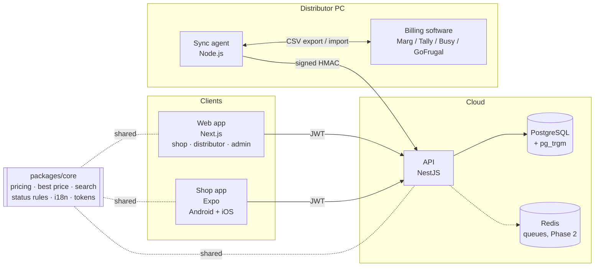

# MediLink architecture

## Key decisions
- **One set of business rules.** Net price after scheme, Best price, typo-tolerant search, WhatsApp list reading, GSTIN checksum and who may change an order's status all live in `packages/core`. The API, web and mobile apps use the same code, so a price shown on a phone is the price billed.
- **Money is integer paise** everywhere: in the database, in the API and in calculations. No floating-point rounding.
- **Credit is reserved when an order is placed** and turned into dues when billed. It is released if the order is rejected or cancelled. Placing an order locks the shop's credit rows, so two phones in one shop cannot overspend.
- **The database enforces the important rules itself**: stock is never negative, billed is never more than ordered, totals always add up, mobile numbers are valid, and the audit log can only be added to.
- **One place changes order status** (`OrderWorkflowService`). It writes the status, event, audit row and notification in a single transaction.
- **Notifications go through an outbox table** written in the same transaction, so a message is never sent for a change that rolled back. A delivery worker (SMS, WhatsApp, push) is Phase 4.
- **Login is OTP only.** Codes are hashed and rate limited. Refresh tokens rotate, and reuse of an old token logs the user out everywhere. Phones keep tokens in the iOS Keychain or Android Keystore.
- **The sync agent pulls; it never listens.** The distributor's PC needs no open ports. Requests are signed with HMAC plus a timestamp.

## Order lifecycle
`PLACED → ACCEPTED → BILLED → DISPATCHED → DELIVERED`, plus `REJECTED` (by the distributor, from PLACED) and `CANCELLED` (by the shop, only while PLACED). Shop screens use the words a shop uses: "On the way", "Came short", "Not accepted".
