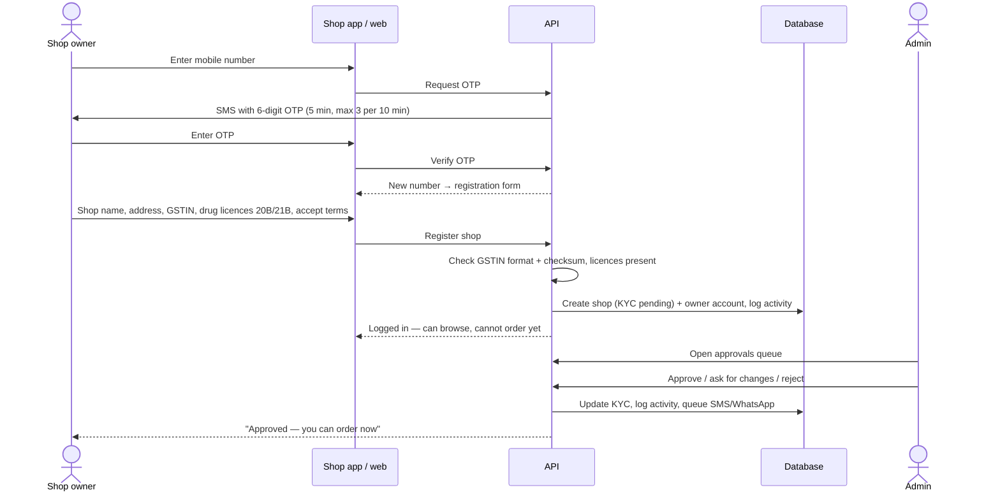
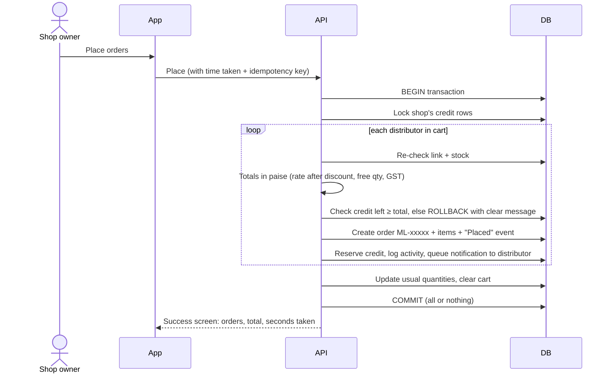
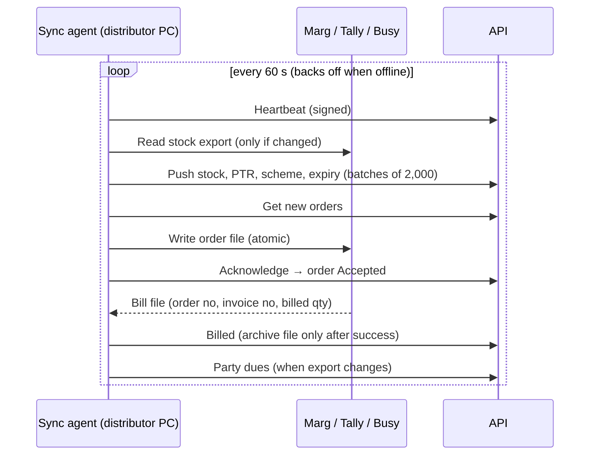
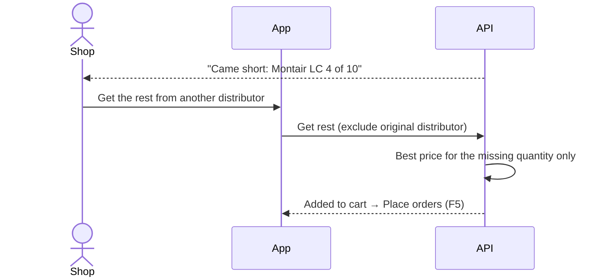
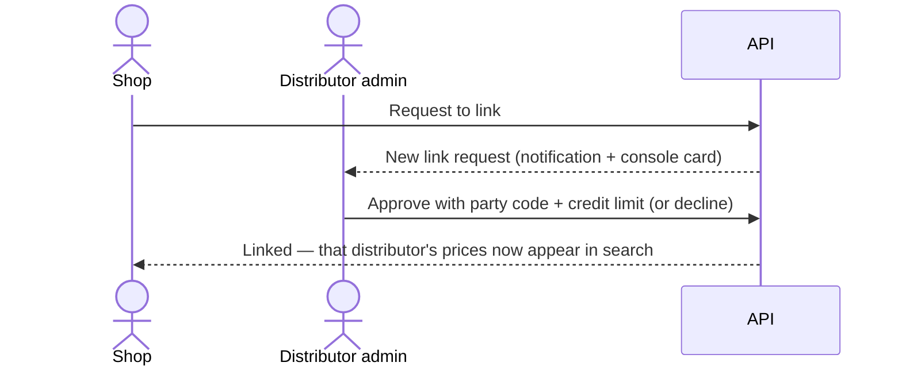
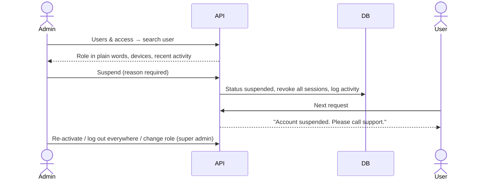
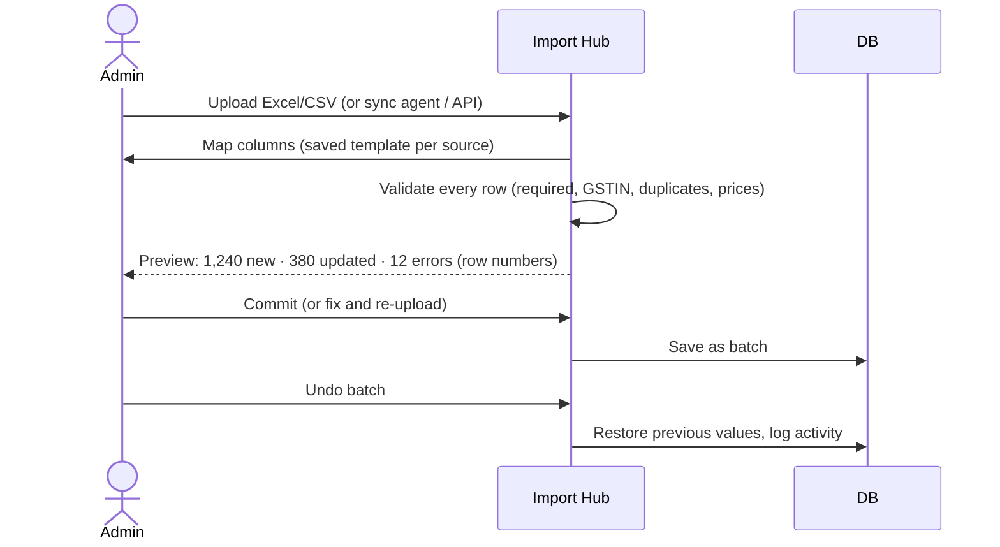
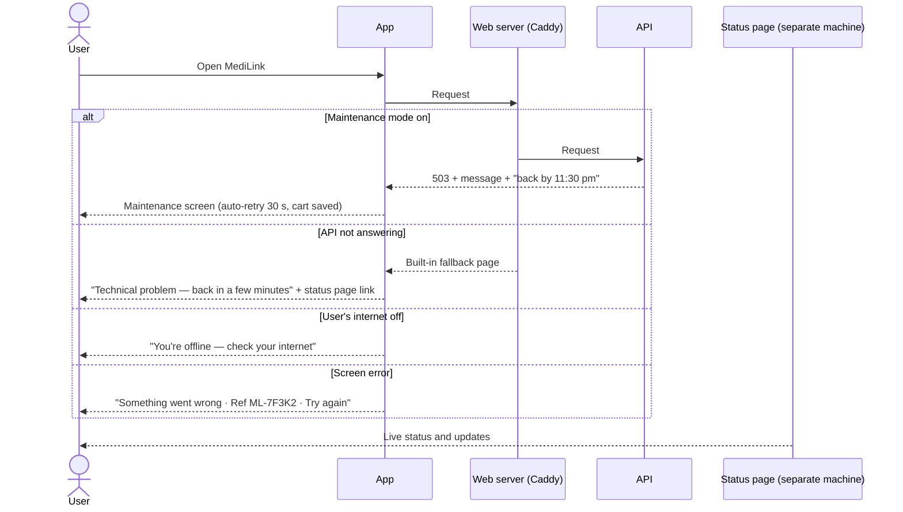
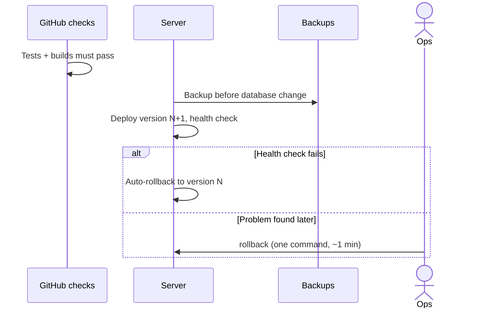
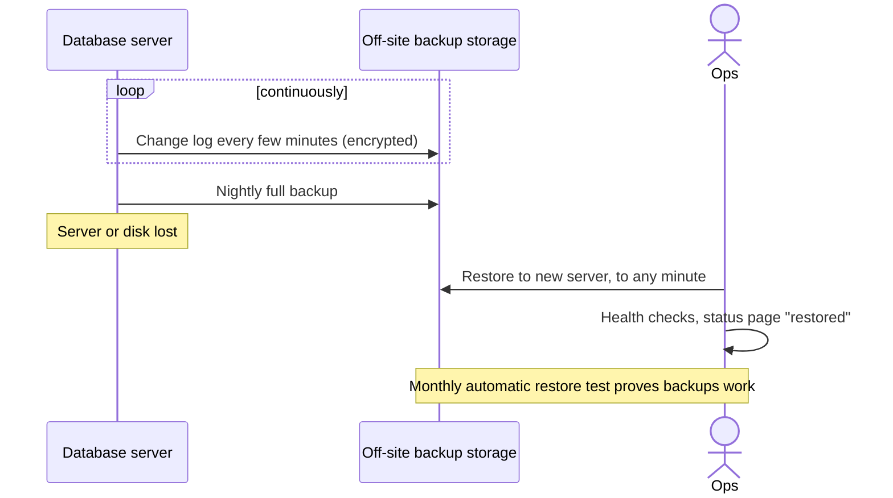

# MediLink — Functional Flow Sequences

Each flow shows who does what, in order. ✅ built · ⏳ planned.

## F1. Shop registration and approval ✅


## F2. Login and staying logged in ✅
```mermaid
sequenceDiagram
  actor User
  participant App
  participant API
  User->>App: Mobile number
  App->>API: Request OTP (rate limited)
  User->>App: OTP
  App->>API: Verify (wrong OTP logged; 5 tries max)
  API-->>App: Access token (15 min) + refresh token (30 days)
  Note over App: Phone stores refresh token in Keychain / Keystore
  App->>API: Every request with access token
  API->>API: Check user still active + current role (suspension applies at once)
  App->>API: Token expired → refresh
  API-->>App: New tokens (old one revoked; reuse = log out everywhere)
```

## F3. Search, compare and add to cart ✅
```mermaid
sequenceDiagram
  actor Shop
  participant App
  participant API
  participant DB
  Shop->>App: Type "dolo" (typos fine)
  App->>API: Search
  API->>DB: Trigram search on name + salt + company
  API->>DB: Offers from linked distributors (stock, PTR, discount, scheme, expiry, credit left)
  API->>API: Best price = in stock → full qty → fits credit → lowest net rate → fastest delivery
  API-->>App: Product cards with best price; substitutes if out everywhere
  Shop->>App: Optional: Compare → pick another distributor
  Shop->>App: Add to cart (usual quantity remembered)
  App->>API: Save cart line (server-side: same cart on phone and web)
```

## F4. Paste a WhatsApp list ✅
```mermaid
sequenceDiagram
  actor Shop
  participant App
  participant API
  Shop->>App: Paste "Dolo 650 - 20 / pan 40 x10 / azithral 5"
  App->>API: Read list
  API->>API: Split lines, read quantities, fuzzy-match each product (confidence score)
  API-->>App: Matched lines; unclear ones marked "?"; unknown ones flagged
  Shop->>App: Add all at best price
  App->>API: Add many (best distributor per item)
  API-->>App: Added N, out of stock: list
```

## F5. Place order (one order per distributor) ✅


## F6. Distributor processes the order — console ✅
```mermaid
sequenceDiagram
  actor D as Distributor staff
  participant Web as Distributor console
  participant API
  participant DB
  actor Shop
  Web->>API: Load lanes (auto-refresh 30 s)
  D->>Web: Accept (or Accept all / Reject with reason)
  Web->>API: Accept
  API->>DB: Lock order, check allowed (rules), set Accepted, event, log
  API-->>Shop: "Accepted"
  D->>Web: Create bill
  API->>DB: Billed qty = min(ordered, stock) per line; reduce stock (never below 0)
  API->>DB: Invoice SVP/26-27/0001; credit reservation → dues; part supply flagged
  API-->>Shop: "Billed" (+ "came short" if partial)
  D->>Web: Send for delivery → Mark delivered (or shop marks "Goods received")
```

## F7. Distributor processes the order — automatic via billing software ✅


## F8. Part supply → get the rest elsewhere ✅


## F9. Shop links a new distributor ✅


## F10. Shortage list (staff → owner) ✅
```mermaid
sequenceDiagram
  actor Staff as Shop staff
  actor Owner
  participant API
  Staff->>API: Save item to shortage list (cannot place orders)
  Owner->>API: Order all at best price
  API-->>Owner: Items in cart; still-out-of-stock items stay on the list
```

## F11. User access management ✅


## F12. Import data with undo ⏳


## F13. System down / maintenance — what users see ✅


## F14. Bad release → rollback ✅


## F15. Disaster recovery ✅


## F16. Payment of dues by UPI ⏳ (Phase 4)
```mermaid
sequenceDiagram
  actor Shop
  participant App
  participant API
  participant PG as Razorpay
  Shop->>App: Pay ₹62,000 to Sri Venkateswara
  App->>API: Create payment (idempotency key)
  API->>PG: Create order
  App->>PG: UPI payment
  PG->>API: Webhook (signed) → mark paid, reduce dues
  Note over API,PG: Never trust the phone's "success" alone; daily reconciliation
```

## F17. Admin login with 2-step verification ✅
```mermaid
sequenceDiagram
  actor Admin
  participant Web as Admin web
  participant API
  participant Phone as Authenticator app
  Admin->>Web: Mobile number → SMS OTP
  Web->>API: Verify OTP
  alt 2-step login already on
    API-->>Web: "Code from your authenticator app" (5-min login ticket, no session yet)
    Admin->>Phone: Read 6-digit code
    Admin->>Web: Code (or a one-time recovery code)
    Web->>API: Verify code (one use per code; 5 wrong tries → 10-min pause)
    API-->>Web: Session marked "2-step passed"
  else Not set up and required (always on a live system)
    API-->>Web: Session limited to the setup screen
    Web->>API: Start setup → QR code
    Admin->>Phone: Scan QR
    Admin->>Web: First code
    API->>API: Turn on, end older sessions, make 10 recovery codes
    API-->>Web: Recovery codes (shown once) + full session
  end
  Note over API: Optional office IP allow-list checked on every admin request
  Note over API: Lost phone → super admin resets 2-step login (logged)
```

## F18. Every shop and distributor request is fenced by the database ✅
```mermaid
sequenceDiagram
  participant App as Shop / distributor app
  participant API
  participant DB as PostgreSQL
  App->>API: Request with login token
  API->>DB: BEGIN; SET LOCAL ROLE medilink_tenant; set shop / distributor id
  API->>DB: The request's queries
  DB-->>API: Only this business's orders, carts, links, dues (others invisible; writing them is refused)
  API->>DB: COMMIT (or ROLLBACK on any error)
  API-->>App: Answer
```
